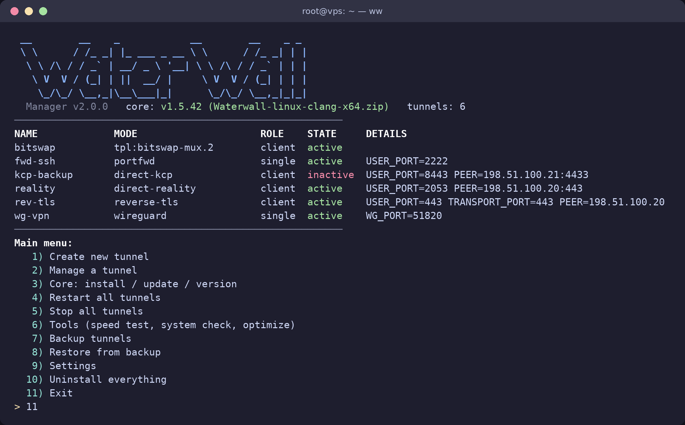
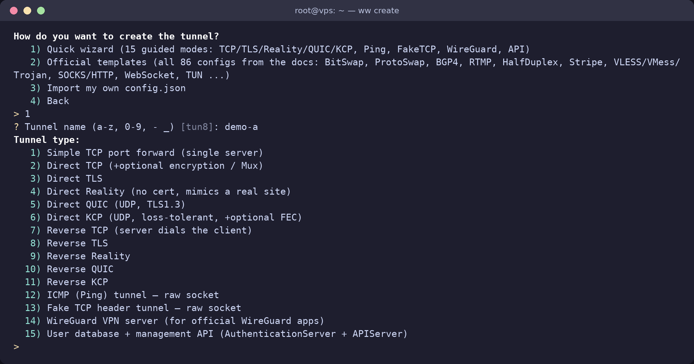
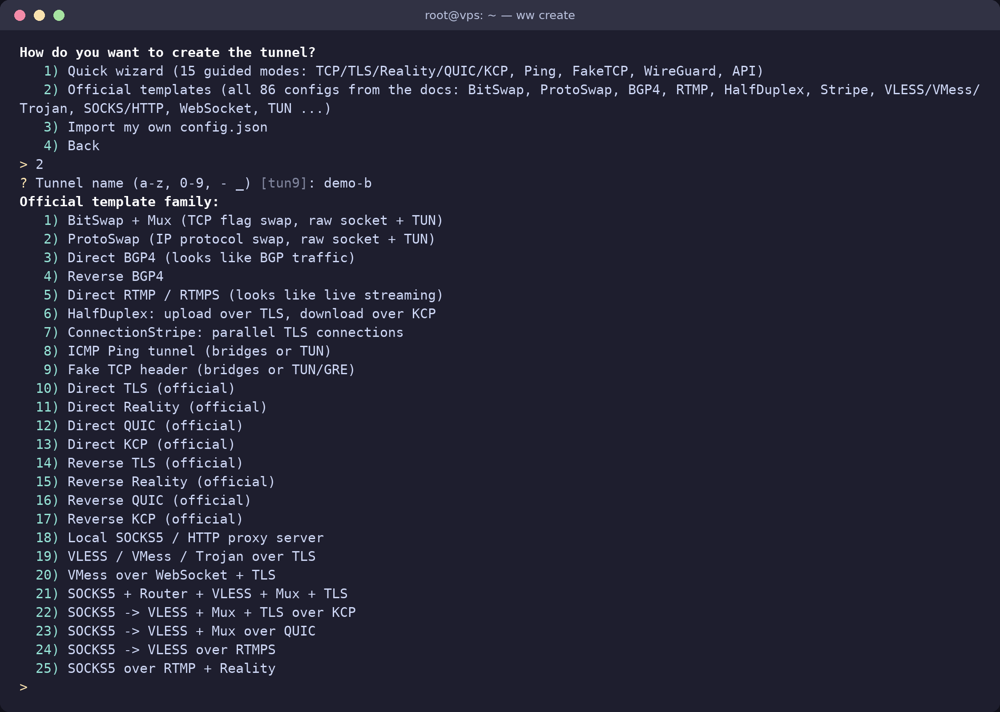
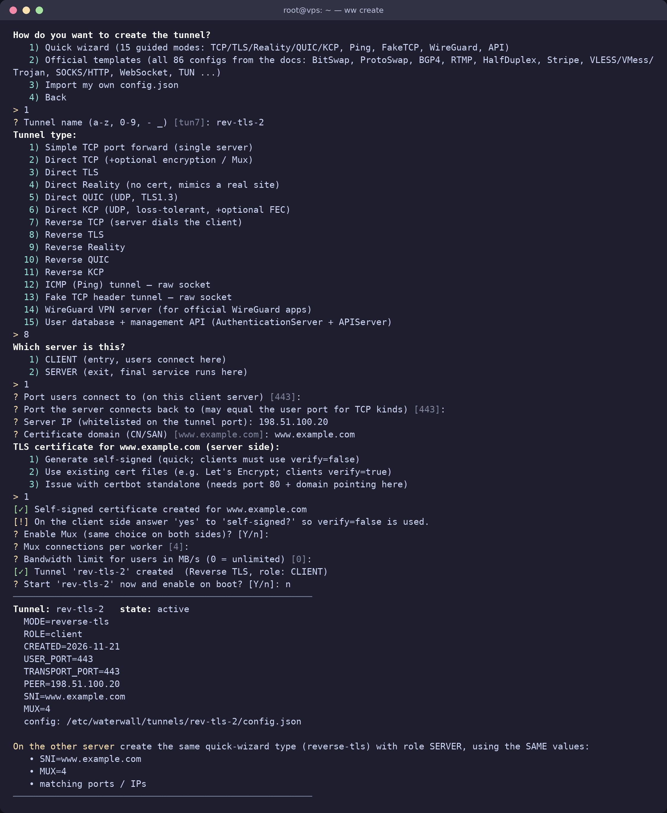
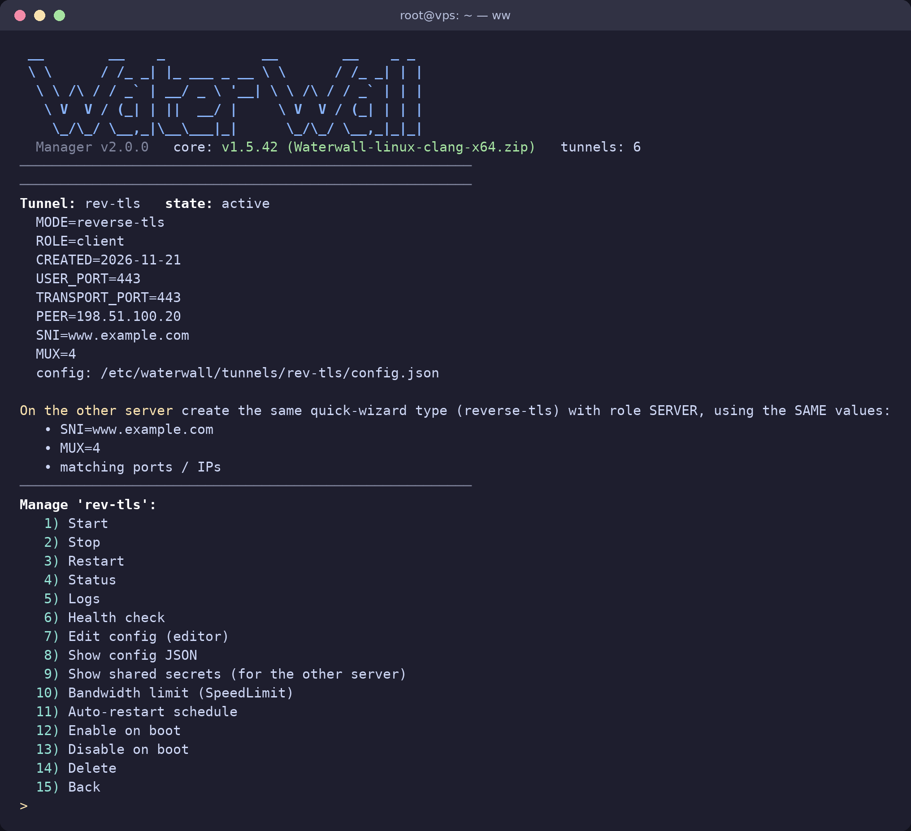
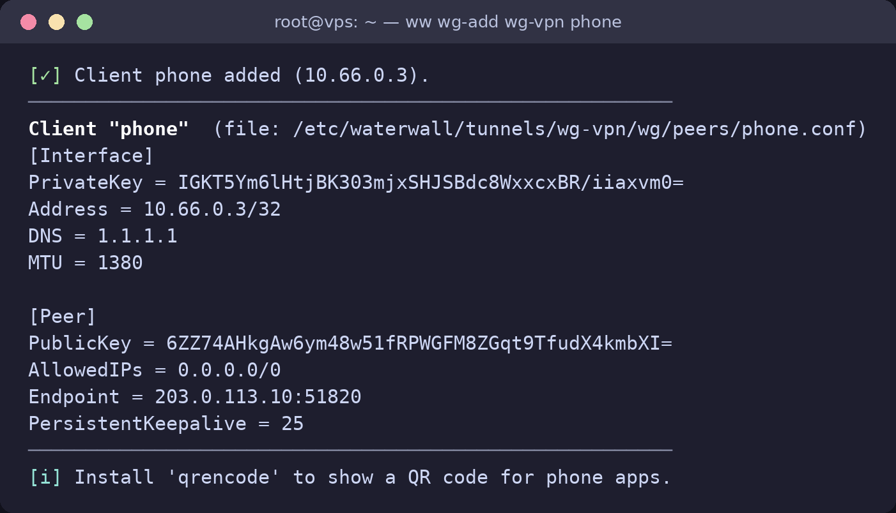
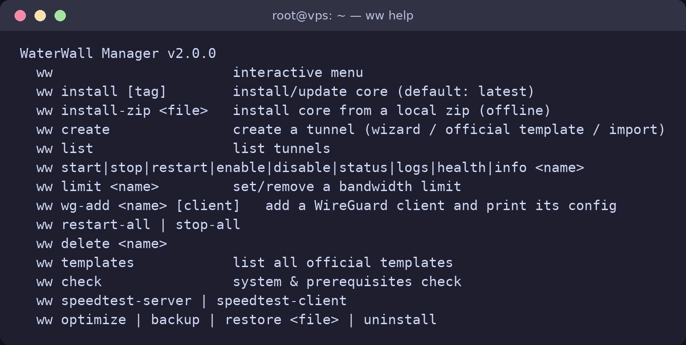

# WaterWall Manager

A modular, menu-driven installer and tunnel manager for
[WaterWall](https://github.com/radkesvat/WaterWall), the chain-based tunneling
framework by radkesvat. It installs the WaterWall core, builds tunnel configs
through guided wizards or the official documentation templates, and runs each
tunnel as its own systemd service.

```
 __        __    _            __        __    _ _
 \ \      / /_ _| |_ ___ _ __ \ \      / /_ _| | |
  \ \ /\ / / _` | __/ _ \ '__| \ \ /\ / / _` | | |
   \ V  V / (_| | ||  __/ |     \ V  V / (_| | | |
    \_/\_/ \__,_|\__\___|_|      \_/\_/ \__,_|_|_|
```

## Features

- **Core installer**: detects the CPU (AVX-512, AVX2, ARM atomics) and downloads
  the matching build. It falls back to the next build if one crashes with an
  illegal instruction. You can also install a specific tag, choose the build by
  hand, or install offline from a local zip.
- **Quick wizard (15 modes)**: port forward, Direct/Reverse TCP, TLS, Reality,
  QUIC and KCP, the ICMP (Ping) tunnel, the Fake TCP header tunnel, a WireGuard VPN
  server and a user database with a management API.
- **Official templates (86 configs in 25 families)**: generated from the
  [WaterWall docs](https://radkesvat.github.io/WaterWall-Docs/) examples. They
  include BitSwap + Mux, ProtoSwap, BGP4, RTMP/RTMPS, HalfDuplex, ConnectionStripe,
  Ping/Fake TCP with TUN, VLESS/VMess/Trojan, SOCKS5/HTTP proxies, WebSocket and
  SOCKS5 over RTMP + Reality.
- **Import your own config**: from a file or pasted JSON, with `$variable$`
  placeholders supported.
- **Optional layers**: ChaCha20 encryption for TCP/KCP, KCP FEC, Mux, and a
  per-tunnel bandwidth limit (SpeedLimit).
- **WireGuard server**: works with the official WireGuard apps. It generates keys,
  sets up NAT and forwarding, lets you add and remove clients (up to 32), and
  writes a `.conf` per client. If `qrencode` is installed, it also shows a QR code.
- **Management**: one systemd service per tunnel (`waterwall@<name>`), live logs,
  health checks, a config editor with validation and rollback, scheduled restarts,
  and backup and restore.
- **Tools**: speed test (server and client), a system and kernel prerequisites
  check, and network tuning (BBR, buffers, file limits).
- **Self-check**: every generated config is validated (JSON, duplicate names,
  unknown node references) before it is saved.

## Screenshots

These screenshots were taken from the real script output in dry-run mode
(see [Testing](#testing)). Tunnel names, IPs, keys and service states are demo data.

**Main menu**



**Quick wizard**



**Official templates**



<details>
<summary>More screenshots</summary>

**Creating a Reverse TLS tunnel on the client side**



**Managing a tunnel**



**Adding a WireGuard client**



**Command-line help**



</details>

## Requirements

- Linux with systemd, run as root
- x86_64 or arm64
- Dependencies are installed automatically when missing: `curl`, `unzip`,
  `openssl`, `jq`, `iproute2`, `iptables`
- Raw-socket and TUN templates also need kernel NFQUEUE, the `xt_bpf` match and
  `/dev/net/tun`

## Installation

Copy the script to the server and run it:

```bash
scp waterwall-manager.sh root@SERVER:/root/
ssh root@SERVER
bash /root/waterwall-manager.sh
```

On the first run it installs itself as `ww`, so afterwards you can run `ww`
from anywhere.

If the repository is private, download it with a fine-grained personal access
token that has read access to this repository only:

```bash
curl -fsSL -H "Authorization: token YOUR_TOKEN" \
  -o waterwall-manager.sh \
  "https://raw.githubusercontent.com/javadkhammari/waterwall-manager./main/waterwall-manager.sh"
bash waterwall-manager.sh
```

### Filtered networks

If GitHub is blocked on the server:

- set a download proxy prefix in **Settings** (for example `https://ghproxy.net/`), or
- download a `Waterwall-linux-*.zip` release elsewhere, copy it to the server and
  run `ww install-zip /path/to/file.zip`.

## Concepts

| Role | Meaning |
| --- | --- |
| **CLIENT** | Entry server. Users connect here. |
| **SERVER** | Exit server, where the final service (for example Xray) runs. |
| **Direct** | The client connects to the server. |
| **Reverse** | The server connects back to the client (useful when the client cannot open outbound connections to the server, or when the server is behind NAT or a firewall). |
| **Single** | Modes that run on one machine only (port forward, WireGuard server, management API). |

Create the same mode on both servers, one with each role, and use the same
shared values (password, SNI, UUID, Mux and encryption settings). After a
tunnel is created, the script prints exactly which values the other server needs.

## Usage

Interactive menu:

```bash
ww
```

Command line:

| Command | Description |
| --- | --- |
| `ww install [tag]` | Install or update the core (default: latest) |
| `ww install-zip <file>` | Install the core from a local zip |
| `ww create` | Create a tunnel (wizard, official template or import) |
| `ww list` | List tunnels and their state |
| `ww start\|stop\|restart <name>` | Control a tunnel |
| `ww enable\|disable <name>` | Start on boot, or not |
| `ww status\|logs\|health\|info <name>` | Inspect a tunnel |
| `ww limit <name>` | Set or remove a bandwidth limit |
| `ww wg-add <name> [client]` | Add a WireGuard client and print its config |
| `ww restart-all` / `ww stop-all` | Control all tunnels |
| `ww delete <name>` | Delete a tunnel |
| `ww templates` | List all official templates |
| `ww check` | System and prerequisites check |
| `ww speedtest-server` / `ww speedtest-client` | Run a speed test |
| `ww optimize` | Apply BBR and network tuning |
| `ww backup` / `ww restore <file>` | Back up or restore all tunnels |
| `ww uninstall` | Remove everything (backups are kept) |

## File layout

```
/opt/waterwall/bin/Waterwall           WaterWall core
/opt/waterwall/bin/ww-hook             runs per-tunnel post-up/post-down hooks
/etc/waterwall/tunnels/<name>/
    config.json                        node chain
    core.json                          core settings (logs, workers, MTU)
    tunnel.meta                        mode, role and shared values
    logs/                              core.log, network.log, ...
    wg/                                WireGuard keys and clients (WireGuard mode)
/etc/waterwall/certs/                  self-signed certificates
/etc/waterwall/backups/                backups
/etc/systemd/system/waterwall@.service
/usr/local/bin/ww                      this manager
```

## Security notes

- **Raw-socket tunnels** (BitSwap, ProtoSwap, Ping, Fake TCP) capture all
  matching traffic from the peer's public IP. SSH between the two servers can
  break, so keep another management path.
- **Self-signed certificates** need `verify=false` on the client side. The
  wizard asks about this. Use a real certificate (Let's Encrypt or certbot)
  when you can.
- **Local SOCKS5/HTTP proxy templates** have no authentication. Keep them on
  `127.0.0.1` or behind a firewall, or anyone can use them as an open proxy.
- **The management API** is not encrypted. Keep it on `127.0.0.1` (the default).
- **XOR obfuscation** in BitSwap/ProtoSwap is not encryption.

## Testing

The script supports a dry-run root for testing without touching the system:

```bash
WW_ROOT=/tmp/wwtest WW_OFFLINE=1 bash waterwall-manager.sh
```

In this mode, all files are written under `$WW_ROOT` and systemd calls are
skipped. In this mode, every wizard mode (both roles) and all 86 official
templates were generated through the menu and passed the config self-check.
Running WaterWall itself with these configs on real servers is the next step.

## Credits

- [WaterWall](https://github.com/radkesvat/WaterWall) by radkesvat
- The official templates come from the
  [WaterWall-Docs](https://github.com/radkesvat/WaterWall-Docs) examples

This project is an independent helper script and is not affiliated with the
WaterWall project.
